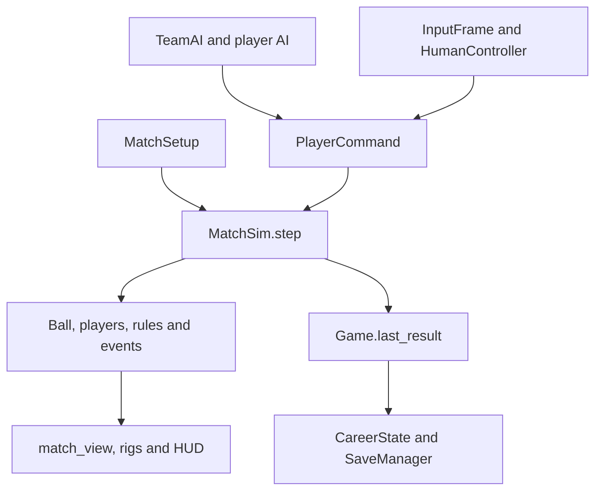

# Project map

Verified against gameplay commit a47746eba365d3a3a1ffc6693069dc2cab484505 on 2026-11-14.
Use this document for navigation. Confirmed defects and evidence are in [the code review](CODE_REVIEW_2026-11-14.md);
the ordered implementation tasks are in [AI_WORK_PLAN.md](AI_WORK_PLAN.md).
Extended audit: [DEEP_AUDIT_2026-11-14.md](DEEP_AUDIT_2026-11-14.md).
Full Claude entry point: [CLAUDE_MASTER_PROMPT_EN.md](CLAUDE_MASTER_PROMPT_EN.md).

## Read before changing behaviour

1. [CLAUDE.md](../CLAUDE.md): invariants and verified commands.
2. [PROGRESS.md](../PROGRESS.md): current checkpoint.
3. This map, then the relevant task in AI_WORK_PLAN.md.
4. The named implementation functions and their actual callers.

Keep CLAUDE.md concise. Update this map when ownership or paths change; update task evidence when behaviour changes.

## Startup and match flow

[project.godot](../project.godot) loads the Game and Sfx autoloads and starts scenes/main_menu.tscn.

- [src/core/game.gd](../src/core/game.gd): _ready loads tuning/settings and registers physical keyboard keys;
  start_match stores pending_setup and return_scene; goto changes scenes.
- [src/ui/main_menu.gd](../src/ui/main_menu.gd): quick match, watch match, settings, career entry, diagnostics.
- [src/career/league_data.gd](../src/career/league_data.gd): builds club squads and MatchSetup team dictionaries.
- [src/view/match_view.gd](../src/view/match_view.gd): _ready constructs MatchSim from Game.pending_setup;
  _physics_process samples input and advances the simulation; _process animates/interpolates its state.
- match_view._finish stores Game.last_result; leave_match returns to Game.return_scene.
- [src/ui/career_hub.gd](../src/ui/career_hub.gd): _absorb_match_result applies the result once, completes the round,
  clears the pending result, and autosaves.

## Data and control ownership

The simulation is RefCounted code, independent of scene nodes. MatchSim is the authority for physical execution,
possession, and rules. TeamAI and HumanController request actions through PlayerCommand.
In MatchSim.step, team AI runs before HumanController, followed by movement, actions, ball integration,
possession, and rules. InputFrame is already expressed in pitch-plane coordinates.

Simulation coordinates: global x runs along the pitch; global y runs across it; ball height is separate.
team.dir is +1 or -1. TeamAI.local/world and SimTeam.to_local/to_world convert between global and team-relative
coordinates. The view maps simulation (x, y, height) to Godot (x, height, y).

Use sim.rng for simulation randomness. Observing existing agent.options is safe; calling OnBallAI.decide again
just to log its candidates consumes randomness and changes behaviour.

## Where each football decision lives

| Concern | File and entry points | Important relationship |
| --- | --- | --- |
| Match state, clock, physics, legal contacts | [match_sim.gd](../src/sim/match_sim.gd): step, _move_players, _try_kick, _register_touch, _possession, _rules | Commands are executed here; rules must inspect the correct pre-touch history. |
| Shared movement/reach estimates | [sim_query.gd](../src/sim/sim_query.gd): time_to_reach, opp_arrival, offside_line_local | Predictions must agree with actual command speed and physical limits. |
| Ball flight and rolling | [ball_state.gd](../src/sim/ball_state.gd): advance, roll_time, roll_speed_for; [sim_ball.gd](../src/sim/sim_ball.gd) | The same integrator supports actual movement and trajectory prediction. |
| Team phase and assignments | [team_ai.gd](../src/ai/team_ai.gd): _replan, _update_side, _plan_attack, _plan_defend | Assigns carrier, receiver, presser, cover, runner, support and marking duties. |
| Numerical advantage and transitions | team_ai.gd: _counter_chance, _update_side, _plan_attack | counter_on is currently latched when possession changes; it is not a general continuously refreshed overload detector. |
| Attacking positioning | team_ai.gd: _refresh_attack_target, _score_spot, _drive_runner; [ai_shape.gd](../src/ai/ai_shape.gd) | Anchors, candidate positions, run timing, onside recovery and formation width. |
| Press or contain | team_ai.gd: _update_engage, _drive_press, _drive_mark | Read these together with presser/cover assignment; avoid solving attacks by weakening defenders. |
| Carrier action choice | [on_ball_ai.gd](../src/ai/on_ball_ai.gd): drive, decide, _apply, _pick, _next_option | Compares passes, through balls, crosses, dribbles, holding and shooting on one utility scale. |
| Pass feasibility and launch | [kick_planner.gd](../src/ai/kick_planner.gd): plan_ground, plan_through, plan_lob, ground_margin | Receiver timing, interception margins and physical launch requests; shared with human assistance. |
| Position and shooting value | [field_value.gd](../src/ai/field_value.gd): value, loss_cost, xg_pos, xg_shot | xg_pos is a heuristic; match statistics currently record it rather than the full decision-time xg_shot model. |
| Per-player tactical memory | [ai_agent.gd](../src/ai/ai_agent.gd) | Duty, commitment, next decision, run state, targets and the candidate buffer survive control switches. |
| Goalkeepers | [keeper_ai.gd](../src/ai/keeper_ai.gd): drive, _path_at_depth | Uses trajectory estimates, reach and reaction limits; MatchSim executes actual catches and parries. |
| Human action assistance | [human_controller.gd](../src/input/human_controller.gd): update, assist_pass, _shot, _manual_switch | Keyboard input and AI share KickPlanner and MatchSim mechanics. |
| Input sampling and pause | match_view.gd: _unhandled_input, _sample_input, set_paused | Handles edge-triggered actions, camera-relative movement and pausing simulation updates. |
| Substitutions and per-identity state | match_sim.gd: substitute, _apply_identity; sim_player.gd; AIAgent; match_view._on_event | Identity changes in the same formation slot; transient physics/action/AI state needs deliberate reset. |

## Configuration

| Location | Purpose |
| --- | --- |
| [src/sim/game_tuning.gd](../src/sim/game_tuning.gd) | Exported defaults for motion, ball control, action execution, AI timing and utility weights. Most current tuning values are defined here. |
| [data/tuning/default_tuning.tres](../data/tuning/default_tuning.tres) | Loaded GameTuning resource; currently mostly inherits the script's defaults. |
| [src/sim/team_tactics.gd](../src/sim/team_tactics.gd) | Width, line height, pressing, passing risk, reaction time, decision noise and difficulty presets. |
| [src/sim/attr.gd](../src/sim/attr.gd), [sim_player.gd](../src/sim/sim_player.gd) | Attribute normalization, position weights, speed and player state. |
| [data/league.json](../data/league.json) | Fictional club metadata used by LeagueData. |

Keep model corrections distinct from numerical retuning. A higher shot multiplier cannot fix inconsistent motion
prediction or an early event trigger.

## Career and save integrity

| Location | Responsibility |
| --- | --- |
| [career_state.gd](../src/career/career_state.gd) | create, standings, lineup_valid, apply_result, complete_round, start_next_season, buy, sell, validate, normalize |
| [schedule.gd](../src/career/schedule.gd) | Double round-robin fixture generation |
| [league_data.gd](../src/career/league_data.gd) | Squad generation, auto_lineup, prices, team_setup |
| [save_manager.gd](../src/career/save_manager.gd) | Temporary-file save, backup and load recovery; trusts CareerState.validate |
| [career_hub.gd](../src/ui/career_hub.gd) | Club screens, transfers, lineup selection, result absorption, autosave |

Fixture played flags guard duplicate results. Standings are derived from fixtures. Participant IDs feed development.
user://saves/career.json is the normal save, with a .bak backup. Test corrupt saves only in an isolated directory.

## Presentation and UI

- scenes/: main menu, match, career hub, and diagnostic roots.
- src/view/: player_rig, ball_view, pitch_view, match_camera, match_view and debug_overlay.
- src/ui/: main_menu, career_hub, match_menus, hud, diagnostic_menu and shared ui_kit.
- locale/strings.csv: translation source; reimport after edits.
- src/core/sfx.gd: generated sound effects and crowd audio.
- export_presets.cfg: Windows export configuration. Exporting is different from testing the executable on Windows.

## Checks and diagnostics

| Command/script | What it establishes |
| --- | --- |
| godot --headless --import | Import/parser/class-registration check |
| tests/run_tests.gd | Core logic assertions; baseline 300 checks, including two tautologies documented in QA01 |
| tools/run_scenarios.gd | Eight diagnostic scenario verdicts; currently exits 0 even when verdicts fail |
| src/ai/scenario_lib.gd | Scenario setup, observations, injected diagnostic input and success predicates |
| tools/review_regressions.gd | Five new failing behavioural regressions from this review; correctly returns exit 1 when they fail |
| tools/deep_audit.gd | Eight deterministic pairs, eight three-season careers, substitution/back-pass/pause/handoff/auto-lineup regressions; select with --case=NAME |
| tools/audit_save_case.gd | Thirty isolated valid/corrupt save cases, one per process; select with --case=NAME |
| tools/run_deep_audit.py | Python 3 stdlib driver: engine pin, 60-second per-case bounds, logs/JSON, completion/error checks; baseline 11/37 subprocess cases pass |
| tools/probe_scn.gd | Event and duty trace for a specific scenario |
| tools/run_match.gd and src/ai/match_report.gd | Full-match observations; metrics are diagnostic evidence rather than an automatic quality verdict |
| tools/fuzz_human.gd | Random-input robustness, not human control feel |
| tools/career_journey.gd | Headless career progression and save/load |
| tools/shot.sh | Xvfb screenshot wrapper; its current error handling is part of QA01 |
| docs/PLAYTEST.md | Human control, animation and difficulty checks |

Use Godot 4.5.1 for comparisons with the recorded baseline. See AI_WORK_PLAN.md for exact commands, dependencies,
expected failures and completion criteria.

## Change-impact paths for the extended findings

| Task | Start here | Also inspect / recheck |
| --- | --- | --- |
| RULE01 / RULE02 | MatchSim._try_kick / _register_touch / _give_possession | Offside snapshot, backpass_team, restart_taker/no_offside, actual keeper contacts; rule counterexamples. |
| INPUT02 | HumanController.update | TeamAI._ball_claims can choose another intercept receiver; preserve user intent without disabling AI interception planning. |
| INPUT03 | match_view.set_paused / _sample_input | HumanController.charging/shot_charge, release events, window focus; UI edges and normal charged shots. |
| SUB01 | MatchSim.substitute | SimPlayer transient fields, AIAgent memory, participants, PlayerRig.refresh_identity, bench/limits. |
| CAREER01 | LeagueData.auto_lineup | Best candidate initial score -1 versus penalized negative scores; CareerState._repair_lineup and UI error contracts. |
| SAVE01 | CareerState.validate then normalize | SaveManager._read trusts validation; reject nested types before casts/iteration. Test isolated primary and backup. |
| AI05 | TeamAI._update_side / _plan_defend | Recovery time series, press/cover commitment, mark targets, scenario observation timing; not yet a proven single cause. |
| V01 | match_camera / ball_view / pitch_view / HUD | Settings and translations; presentation changes must leave simulation snapshots identical. |
| T01 | TeamAI attack targets / AIAgent passer memory / OnBallAI._next_option | Existing support and runner duties, KickPlanner feasibility, offside and human handoff; no second coordinator. |

Historical logs and four actual rendered captures: `docs/evidence/deep-audit-2026-11-14/`.
Brainstorm ideas beyond V01/T01 are in `IMPROVEMENT_IDEAS.md`, not automatically approved feature tasks.
