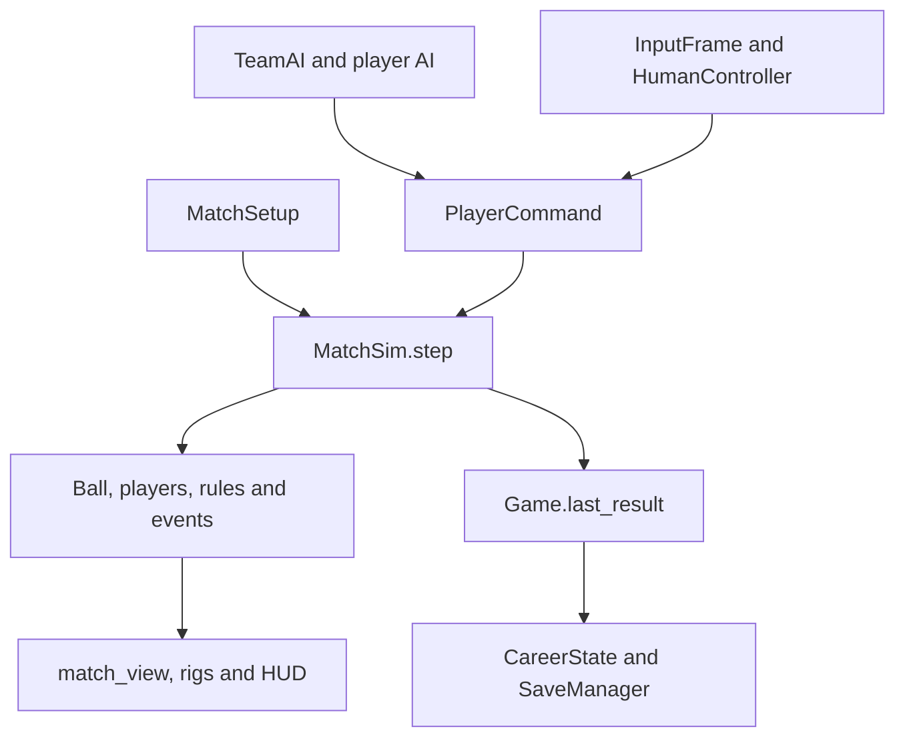

# Project map

Updated against implementation 3d08f8b150aeadef10081d69a0fce0f050f991c0 on 2026-11-14.
Latest independent findings: [GAMEPLAY_REVIEW_2026-11-14.md](GAMEPLAY_REVIEW_2026-11-14.md).
Current runtime paths below exist at that revision. The player-career section explicitly marks proposed
integration boundaries; it does not claim the new mode or those files already exist.
Use this document for navigation. Confirmed defects and evidence are in [the code review](CODE_REVIEW_2026-11-14.md);
the ordered implementation tasks are in [AI_WORK_PLAN.md](AI_WORK_PLAN.md).
Extended audit: [DEEP_AUDIT_2026-11-14.md](DEEP_AUDIT_2026-11-14.md).
Full Claude entry point: [CLAUDE_MASTER_PROMPT_EN.md](CLAUDE_MASTER_PROMPT_EN.md).

## Read before changing behaviour

1. [CLAUDE.md](../CLAUDE.md): invariants and verified commands.
2. [PROGRESS.md](../PROGRESS.md): current checkpoint.
3. The queue index and active task in AI_WORK_PLAN.md, then the relevant rows of this map.
4. Actual implementation/callers and the particular spec/audit sections the task cites. Load PC contracts
   from [PLAYER_CAREER_SPEC.md](PLAYER_CAREER_SPEC.md) as needed, not all historical logs every session.

Keep CLAUDE.md concise. Update this map when ownership or paths change; update task evidence when behaviour changes.

## Startup and match flow

[project.godot](../project.godot) loads the Game and Sfx autoloads and starts scenes/main_menu.tscn.

- [src/core/game.gd](../src/core/game.gd): _ready loads tuning/settings and registers physical keyboard keys;
  start_match stores pending_setup and return_scene; goto changes scenes.
- [src/ui/main_menu.gd](../src/ui/main_menu.gd): quick match, watch match, settings, career entry, diagnostics.
- [src/career/league_data.gd](../src/career/league_data.gd): builds club squads and MatchSetup team dictionaries.
- [src/view/match_view.gd](../src/view/match_view.gd): _ready constructs MatchSim from Game.pending_setup;
  _physics_process samples input and advances the simulation; _process animates/interpolates its state;
  _exit_tree calls sim.dispose. set_paused resets edges/shot actions; focus-out pauses human matches.
- match_view._finish stores Game.last_result; leave_match returns to Game.return_scene.
- [src/ui/career_hub.gd](../src/ui/career_hub.gd): _absorb_match_result applies the result once, completes the round,
  clears the pending result, and autosaves.

## Data and control ownership

The simulation is RefCounted code, independent of scene nodes. MatchSim is the authority for physical execution,
possession, and rules. TeamAI and HumanController request actions through PlayerCommand.
In MatchSim.step, team AI runs before HumanController, followed by movement, actions, ball integration,
possession, and rules. InputFrame is already expressed in pitch-plane coordinates.

Simulation coordinates: global x runs along the pitch; global y runs across it; ball height is separate.
team.dir is +1 or -1. TeamAI.local/world and SimTeam.to_local/to_world convert between global and team-relative
coordinates. The view maps simulation (x, y, height) to Godot (x, height, y).

Use sim.rng for simulation randomness. Observing existing agent.options is safe; calling OnBallAI.decide again
just to log its candidates consumes randomness and changes behaviour.

MatchSim.dispose is idempotent and required when an owner releases a match. It disconnects event listeners,
disposes TeamAI/HumanController and drops back-references. MatchReport.detach releases its own sim reference.
Substitution resets SimPlayer transient state and replaces the slot's AIAgent; UID changes, slot ID stays.
TeamAI.take_run_event consumes a due runner notification once; on_restart discards pending notifications.

## Where each football decision lives

| Concern | File and entry points | Important relationship |
| --- | --- | --- |
| Match state, clock, physics, legal contacts | [match_sim.gd](../src/sim/match_sim.gd): step, _move_players, _try_kick, _register_touch, _possession, _rules | Commands are executed here; rules must inspect the correct pre-touch history. |
| Shared movement/reach estimates | [sim_query.gd](../src/sim/sim_query.gd): carry_speed/carry_time, time_to_reach, opp_arrival, offside_line_local | Normal-gait carry forecasts repaired; recovery branch still inconsistent. |
| Ball flight and rolling | [ball_state.gd](../src/sim/ball_state.gd): advance, roll_time, roll_speed_for; [sim_ball.gd](../src/sim/sim_ball.gd) | The same integrator supports actual movement and trajectory prediction. |
| Team phase and assignments | [team_ai.gd](../src/ai/team_ai.gd): _replan, _update_side, _plan_attack, _plan_defend | Assigns carrier, receiver, presser, cover, runner, support and marking duties. |
| Numerical advantage and transitions | team_ai.gd: _counter_chance, _update_side, _plan_attack | counter_on is currently latched when possession changes; it is not a general continuously refreshed overload detector. |
| Attacking positioning | team_ai.gd: _refresh_attack_target, _score_spot, _drive_runner; [ai_shape.gd](../src/ai/ai_shape.gd) | Anchors, candidate positions, run timing, onside recovery and formation width. |
| Press or contain | team_ai.gd: _update_engage, _drive_press, _drive_mark | Read these together with presser/cover assignment; avoid solving attacks by weakening defenders. |
| Carrier action choice | [on_ball_ai.gd](../src/ai/on_ball_ai.gd): drive, decide, _apply, _pick, _next_option | Compares passes, through balls, crosses, dribbles, holding and shooting on one utility scale. |
| Pass feasibility and launch | [kick_planner.gd](../src/ai/kick_planner.gd): plan_ground, plan_through, plan_lob, ground_margin | Receiver timing, interception margins and physical launch requests; shared with human assistance. |
| Position and shooting value | [field_value.gd](../src/ai/field_value.gd): value, loss_cost, xg_pos, xg_shot | xg_pos is a heuristic; match statistics currently record it rather than the full decision-time xg_shot model. |
| Per-player tactical memory | [ai_agent.gd](../src/ai/ai_agent.gd) | Duty, commitment, next decision, run state, targets and the candidate buffer survive control switches. |
| Goalkeepers | [keeper_ai.gd](../src/ai/keeper_ai.gd): drive, _path_at_depth | Uses trajectory estimates, reach and reaction limits; MatchSim executes actual catches and parries. |
| Human action assistance | [human_controller.gd](../src/input/human_controller.gd): update, assist_pass, _shot, _manual_switch | Keyboard input and AI share KickPlanner and MatchSim mechanics. |
| Input sampling and pause | match_view.gd: _unhandled_input, _sample_input, set_paused | Handles edge-triggered actions, camera-relative movement and pausing simulation updates. |
| Substitutions and per-identity state | match_sim.gd: substitute, _apply_identity; sim_player.gd; AIAgent; match_view._on_event | Identity changes in the same formation slot; transient physics/action/AI state needs deliberate reset. |

## Configuration

| Location | Purpose |
| --- | --- |
| [src/sim/game_tuning.gd](../src/sim/game_tuning.gd) | Exported defaults for motion, ball control, action execution, AI timing and utility weights. Most current tuning values are defined here. |
| [data/tuning/default_tuning.tres](../data/tuning/default_tuning.tres) | Loaded GameTuning resource; currently mostly inherits the script's defaults. |
| [src/sim/team_tactics.gd](../src/sim/team_tactics.gd) | Width, line height, pressing, passing risk, reaction time, decision noise and difficulty presets. |
| [src/sim/attr.gd](../src/sim/attr.gd), [sim_player.gd](../src/sim/sim_player.gd) | Attribute normalization, position weights, speed and player state. |
| [data/league.json](../data/league.json) | Fictional club metadata used by LeagueData. |

Keep model corrections distinct from numerical retuning. A higher shot multiplier cannot fix inconsistent motion
prediction or an early event trigger.

## Career and save integrity

| Location | Responsibility |
| --- | --- |
| [career_state.gd](../src/career/career_state.gd) | create, standings, lineup_valid, apply_result, complete_round, start_next_season, buy, sell, validate, normalize |
| [schedule.gd](../src/career/schedule.gd) | Double round-robin fixture generation |
| [league_data.gd](../src/career/league_data.gd) | Squad generation, auto_lineup, prices, team_setup |
| [save_manager.gd](../src/career/save_manager.gd) | Temporary-file save, backup and load recovery; trusts CareerState.validate |
| [career_hub.gd](../src/ui/career_hub.gd) | Club screens, transfers, lineup selection, result absorption, autosave |

Fixture played flags guard duplicate results. Standings are derived from fixtures. Participant IDs feed development.
user://saves/career.json is the normal save, with a .bak backup. Test corrupt saves only in an isolated directory.

## Presentation and UI

- scenes/: main menu, match, career hub, and diagnostic roots.
- src/view/: player_rig, ball_view, pitch_view, match_camera, match_view and debug_overlay.
- src/ui/: main_menu, career_hub, match_menus, hud, diagnostic_menu and shared ui_kit.
- locale/strings.csv: translation source; reimport after edits.
- src/core/sfx.gd: generated sound effects and crowd audio.
- export_presets.cfg: Windows export configuration. Exporting is different from testing the executable on Windows.

## Checks and diagnostics

| Command/script | What it establishes |
| --- | --- |
| godot --headless --import | Import/parser/class-registration check |
| tests/run_tests.gd | 421 checks at bbe7dbb; old tautologies repaired; budget/lineup deliberate violations exit 1 |
| tools/run_scenarios.gd | Eight scenario verdicts; exit 1 on failures, 2 on unknown/empty selection |
| src/ai/scenario_lib.gd | Scenario setup, observations, injected diagnostic input and success predicates |
| tools/review_regressions.gd | Five original review regressions now pass; failure exits 1 |
| tools/deep_audit.gd | Eight deterministic pairs, eight three-season careers, substitution/back-pass/pause/handoff/auto-lineup regressions; select with --case=NAME |
| tools/audit_save_case.gd | 32 isolated valid/corrupt save cases, one per process; select with --case=NAME |
| tools/session2_review.gd | Five independent boundary regressions: missing history, extra attribute, fitness type, fixture pairing and legal keeper selection; --case=NAME |
| tools/run_deep_audit.py | Pinned strict driver; old 47/47 pass, expanded 47/49; --group gameplay selects the new cases |
| tools/gameplay_review.gd | carry_recovery / urgent_pressure regressions; transition_trace observes production defence without replanning for logs |
| tools/probe_run_event.gd | Observes existing carrier decisions near runner events without rerunning the planner |
| tools/probe_scn.gd | Event and duty trace for a specific scenario |
| tools/run_match.gd and src/ai/match_report.gd | Full-match observations; metrics are diagnostic evidence rather than an automatic quality verdict |
| tools/fuzz_human.gd | Random-input robustness, not human control feel |
| tools/career_journey.gd | Headless career progression and save/load |
| tools/shot.sh | Checks dependencies, engine status, script errors and PNG signature; missing dependency exits 2 |
| docs/PLAYTEST.md | Human control, animation and difficulty checks |

Use Godot 4.5.1 for comparisons with the recorded baseline. See AI_WORK_PLAN.md for exact commands, dependencies,
expected failures and completion criteria.

## Change-impact paths for the extended findings

| Task | Start here | Also inspect / recheck |
| --- | --- | --- |
| RULE01 / RULE02 | MatchSim._try_kick / _register_touch / _give_possession | Offside snapshot, backpass_team, restart_taker/no_offside, actual keeper contacts; rule counterexamples. |
| INPUT02 | HumanController.update | TeamAI._ball_claims can choose another intercept receiver; preserve user intent without disabling AI interception planning. |
| INPUT03 | match_view.set_paused / _sample_input | HumanController.charging/shot_charge, release events, window focus; UI edges and normal charged shots. |
| SUB01 | MatchSim.substitute | SimPlayer transient fields, AIAgent memory, participants, PlayerRig.refresh_identity, bench/limits. |
| CAREER01 | LeagueData.auto_lineup | Negative-score crash and hard GK eligibility repaired; auto/repair preserve state on failure. |
| SAVE01 | CareerState.validate then normalize | Optional lists migrated; closed attrs, fitness and schedule multiplicity checked; prior boundary tests pass. |
| AI02 residuals | SimQuery.carry_speed, OnBallAI.drive | Recovery execution versus forecast; urgent entry versus ordinary decision deadline. |
| AI05 | TeamAI._update_side / _plan_defend | Recovery time series, press/cover commitment, mark targets, scenario observation timing; not yet a proven single cause. |
| V01 | match_camera / ball_view / pitch_view / HUD | Settings and translations; presentation changes must leave simulation snapshots identical. |
| T01 | TeamAI attack targets / AIAgent passer memory / OnBallAI._next_option | Existing support and runner duties, KickPlanner feasibility, offside and human handoff; no second coordinator. |

Historical logs and four actual rendered captures: `docs/evidence/deep-audit-2026-11-14/`.
The current queue identifies approved follow-on ideas. Remaining entries in `IMPROVEMENT_IDEAS.md` stay backlog.

## Player career integration map (planned; PC00–PC09)

The earlier SAVE01 defect baseline is repaired through session 3; the current review reopens AI02 only.

These are candidate ownership boundaries, **not existing files or a requirement to generate empty modules**.
Prefer a focused extension of existing functions where it stays clear. Update this map to actual paths only
after implementation. All PC data/acceptance contracts live in PLAYER_CAREER_SPEC; statuses live in the queue.

| Responsibility | Existing entry/callers to extend | Possible new focused owner | Tasks |
| --- | --- | --- | --- |
| Mode/profile, compatible saves, result context | CareerState, SaveManager, Game.start_match, career_hub._absorb_match_result | `src/career/player_career_state.gd` facade over the same world; not a duplicate player/league DB | PC00 |
| Locked UID and bench/substitute binding | MatchSetup, HumanController.update/on_restart/_set_controlled, MatchSim.substitute, match_view._finish/leave_match | Explicit TEAM/PLAYER_LOCKED fields and policy in existing owners | PC01 |
| Neutral per-UID minutes/actions | MatchSim events/participants, SimPlayer.uid, MatchStats, MatchReport | `src/career/match_participation_record.gd` with explicit attach/detach | PC02 |
| Role rating, form/trust/reputation evidence | Actual participation facts, Attr role weights | `src/career/player_assessment.gd` outside simulation | PC02, PC04 |
| Weekly training and bounded growth | CareerState._develop/apply_result, Attr, persisted award ledger | `src/career/career_development.gd`; `career_tuning.gd` / `data/tuning/career_tuning.tres` | PC03 |
| Coach/club/country selection | LeagueData.auto_lineup, CareerState.lineup_valid, readiness and actual rivals | `src/career/career_selection.gd` with context-scoped trust | PC04, PC07 |
| Multi-league dates, aging/youth pools, competition tables | Schedule, LeagueData, CareerState.complete_round/start_next_season/standings | `src/career/career_world.gd`; reuse per-competition schedule/table helpers | PC05 |
| Offers/contracts/loans | CareerState.buy/sell/_move_player, budgets and active registration | `src/career/career_contracts.gd`; one atomic roster/budget path | PC06 |
| U21/senior fixtures and national return | World calendar, MatchSetup, Game.last_result, explicit result context | Existing world/selection/coordinator owners; national roster contains references to the same players | PC07 |
| Weekly hub/history/menu routes | main_menu, Game scene flow, UIKit, HUD, translations | `src/ui/player_career_hub.gd`, `scenes/player_career_hub.tscn` if a separate scene is useful | PC08 |
| Mode-aware tests/long journey | Existing tests, audit tools, career_journey, PLAYTEST | `tests/player_career_tests.gd`, `tools/player_career_journey.gd` (future outputs, not baseline commands) | PC00–PC09 |

Critical cross-mode relationships:

- The existing HumanController automatically follows owner/receiver. That remains TEAM behaviour; PC01 adds
  a separate locked policy rather than globally deleting the INPUT02 fix or making both modes hand off.
- Substitution reuses a SimPlayer slot. The avatar is a UID, so leaving/entering the pitch needs identity-aware
  binding and recording. TEAM fuzz's exactly-one-human assertion is not universal for a benched avatar.
- `Game.last_result` currently returns a fixture ID and club-oriented data to career_hub. Add context-aware
  routing before national matches; never feed their result into club complete_round or overwrite user_club.
- Existing participation development and new player progression share one award owner. Preserve old behaviour
  for club mode while preventing double apps/attributes in player mode.
- `player.club` currently matches active squad membership. Loans need a separate owning-club contract field;
  national callups are neither a transfer nor another active club membership.
- The current fixed ROUNDS/single-league iteration must stay valid for old saves. PC05 introduces explicit
  competition/date coordination; changing one constant is not a multi-league calendar implementation.
- Current save validation passes the existing controls (SAVE01). Preserve that gate when adding migration/world fields;
  isolate the player slot and validate every new reference/ledger/container before normalization.

## Selected gameplay extensions and idea ownership

### Human-control slice (proposed, not implemented)

Contract: HUMAN_GAMEPLAY_SPEC.md. Existing owners below are real; future methods/tunables must be mapped
after implementation rather than treated as already available. The single queue supplies status/order.

| Concern | Existing owners | Queue |
| --- | --- | --- |
| Held approach, manual override, action reset | InputFrame, HumanController.update/reset_actions, Game._register_input/settings, match_view._sample_input/set_paused | INPUT04 |
| Receive/loose-ball movement | HumanController handoff, TeamAI.intercept/SimQuery shared read-only geometry, MatchSim contact execution | INPUT05; PC01 later enforces UID policy |
| Landing/intercept/next-switch cues | ball_view, HUD, match_camera, HumanController._manual_switch; use read-only selection/prediction helpers | V01, existing V03/U01 ideas |
| Bounded pursuit perception | TeamTactics, TeamAI._ball_claims/_drive_chase, SimQuery/ball-path estimate, explicit seeded cache disposal | AI06 |

Do not move authoritative ball physics into the view or give assistance physical bonuses. No full second
team planner, new world DB or duplicate career loop is required for this slice.

| Direction | Existing extension points | Queue / scope |
| --- | --- | --- |
| Give-and-go / third man | AIAgent passer memory, TeamAI support targets, OnBallAI._next_option | T01, first improvement slice |
| Directional first touch | MatchSim._free_ball_contacts/_give_possession, InputFrame/PlayerCommand, player_rig | B01 after basic human controls, before career expansion; shared mechanics |
| Prepared powerful low shot | HumanController._shot, KickPlanner.plan_shot, shared execution, input/help | B04; preserve INPUT03 and player-locked controls |
| Team style | TeamTactics, TeamAI phase/utility, menu/world metadata | T07; PC05 can use existing tactic values before refinement |
| Attacking rotations | TeamAI._plan_attack/_refresh_attack_target, rest-defence assignments and _plan_defend | T08; extend the current compensation mechanism |
| Playable drills | ScenarioLib, diagnostic_menu, MatchSetup, weekly training ledger | P01; replayability must not duplicate training rewards |

Player-career paths remain proposed. The review changes diagnostics/docs only; check actual HEAD before use.
Keep historical evidence, current task status and proposed design distinct when resuming.
